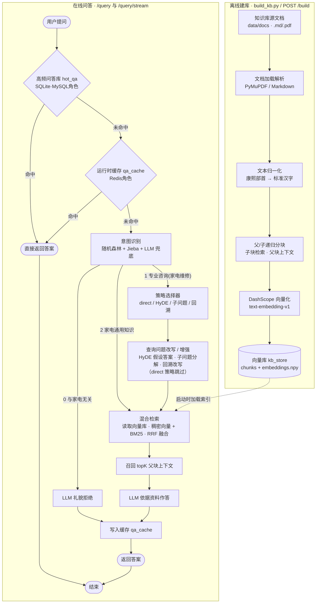

# 智能家电维修问答系统

> 功能等同原 `Itcast_qa_system`，但**自包含、依赖最少**，按 `RAG项目流程图简版.pdf` 的流程实现。
> 服务运行在**本机（Windows）**，DashScope 的 embedding / LLM 调用由本机直接发起；WSL 仅作为可选部署方式。

---

## 一、项目介绍

这是一个面向「智能家电维修」售后/咨询场景的 RAG（Retrieval-Augmented Generation）问答系统。用户提出问题后，系统会：

1. 先查**高频问答库**与**运行时缓存**（命中直接返回，省时省钱）；
2. 再用**随机森林 + Jieba 分词加权 + OpenRouter 免费模型兜底**判断问题是「家电通用知识/与家电无关」还是「家电维修专业咨询」；
3. 家电通用知识由大模型直接作答；与家电无关的问题礼貌拒绝（均不检索、不缓存）；家电维修专业咨询则走 **RAG 全流程**：策略选择 → 混合检索（向量 + BM25）→ 召回资料 → 大模型依据资料作答。

相比原项目，本系统用 **SQLite**（扮演 MySQL 高频问答 + Redis 缓存）、**numpy 轻量向量库**（扮演 Milvus）、**BM25 + RRF**（扮演 reranker），实现了"功能相同、依赖最少、本机一键运行"。

---

## 二、功能特性

| 特性 | 说明 |
| --- | --- |
| 🧠 意图识别 | 随机森林（`FIXRAG.rf.joblib`）+ Jieba 术语加权 + Jev 二分类兜底，两级判定：先判是否家电维修专业咨询（RAG），非咨询再判是否家电通用知识（LLM 直答 / 礼貌拒绝） |
| ⚡ 高频问答库 | SQLite 扮演 MySQL 角色，精确命中直接返回；可用 `seed_qa.json` 灌入 |
| 🗃️ 运行时缓存 | SQLite 扮演 Redis 角色；语义余弦 ≥0.75 的候选再经 Jev 判定同义才命中/合并，句式相同但关键信息不同（如换品牌/型号）不合并；通用知识不缓存 |
| 🧭 策略选择器 | 自动 / 直接检索 / HyDE 假设检索 / 子问题分解 / 回溯简化 |
| 🔀 混合检索 | DashScope 稠密向量 + BM25 稀疏检索，RRF 融合重排 |
| 📚 父/子分块 | 子块召回 + 父块上下文，保证召回粒度和上下文完整性 |
| 🖥️ 内置前端 | 根路径即网页界面：顶部「对话 / 高频问答库 / 运行时缓存 / 向量库 / 项目说明」栏目切换 |
| ⚡ 流式输出 | `/query/stream` SSE 逐段返回，前端逐字渲染 |
| 🧩 过程可视化 | 「🧠 思考过程」(LLM thinking) 与「🔧 工具调用」(流程步骤+检索细节) 两个独立可折叠面板 |
| 📄 参考文档面板 | 每条参考标注 **【资料N】**、真实文件路径、检索得分，展开可看原文段落 |
| 📊 富文本渲染 | 参考原文含 HTML（表格）或 Markdown 时按对应格式渲染（marked.js） |
| 🔤 文本归一化 | 入库与查询两侧统一做 Unicode NFKC 归一化与映射表清洗，减少字符形态差异带来的检索噪声 |
| 🔁 自动建库跳过 | `kb_store/` 已存在索引时自动跳过向量化，秒级启动 |

---

## 三、系统流程图



---

## 四、处理流程详解

1. **高频问答库 + 缓存**：先查本地 SQLite 高频问答库（精确命中直接返回），再查运行时缓存（精确命中直接返回；语义相似候选还需 Jev 判定同义后才命中，句式相同但关键信息不同——如换品牌/型号——不命中），均无需网络。
2. **意图识别（两级二分类）**：随机森林输出 `0=通用知识 / 1=专业咨询` 二分类原始结果，再分两级逐步判定，每级都是更聚焦的二分类：
   - **第一级「是否专业咨询（家电维修）」**：加权分 `0.3×P(专业) + 0.7×术语分`（术语分越高越不可能是咨询）；命中**咨询关键词**（故障/不制冷/漏水/报错/维修/保养/配件/型号/保修等）→ 直接**专业咨询(1)**；命中**强术语**（变频/压缩机/能效/制冷剂等，且无咨询关键词）→ 非咨询信号足够强，跳过 Jev；其余情况调用 **Jev**（OpenRouter 快速决策模型，默认 `inception/mercury-decide:free`，Decisions API 的 choice typed question）做 `consult / not_consult` 二分类，融合分 `0.5×加权 + 0.5×Jev` ≥0.5 → 专业咨询；
   - **第二级「是否家电通用知识」**（仅第一级判非专业咨询时）：命中强术语 → **家电通用知识(2)**（LLM 直答，避免“什么是变频空调”误走 RAG 拉不到资料）；否则调 **Jev** 做 `tech_general / unrelated` 二分类 → 家电通用知识(2) 或 与家电无关(0)；
   - Jev 调用失败（网络/限流/超时）时自动降级：第一级用加权分 ≥0.5 判专业咨询，第二级命中普通术语 → 家电通用知识，否则 → 与家电无关。
3. **专业咨询分支**：
   - **策略选择器**：`auto` 自动选择 直接检索 / HyDE 假设检索 / 子问题分解 / 回溯简化 之一。
   - **混合检索**：DashScope `text-embedding-v1` 稠密向量 + BM25 稀疏检索，RRF 融合重排。
   - **召回**：子块召回后取所属**父块**作为上下文，保证答案依据完整。
   - **生成**：LLM 依据召回的 topK 父块上下文作答，并返回 `sources` 参考信息。
4. **离线建库**：`data/docs` 文档（MD/PDF）→ 父/子分块 → DashScope 向量化 → 持久化到 `kb_store/`。

---

## 五、目录结构

```
D:\models\edurag\
├── app.py                 # FastAPI 服务入口（/query /query/stream /build /seed /stats /health /db/*）
├── build_kb.py            # 知识库索引构建脚本（命令行一键建库）
├── run.bat                # Windows 一键启动脚本（已建库时自动跳过向量化）
├── requirements.txt       # Python 依赖
├── seed_qa.json           # 高频问答种子数据（可灌入 hot_qa）
├── .env.example           # 配置模板（复制为 .env 使用）
├── .gitignore             # 已忽略 .venv/ kb_store/ .env 等
├── data/
│   └── docs/              # 知识库源文档（.md / .pdf）
├── docs_project/          # 项目文档（如 RAG 流程图 PDF，原 docs/ 改名）
├── eval/
│   └── ragas_eval.py      # RAGAS 四指标评测脚本（检索相关性/检索召回率/生成忠实度/生成相关性）
├── models/                # 意图识别模型与训练数据（FIXRAG.rf.joblib）
├── static/
│   └── index.html         # 内置前端页面（对话 + 三个数据库栏目 + 项目说明）
├── src/
│   ├── config.py          # 配置 + DashScope key 加载（Windows/WSL 自动识别路径）
│   ├── dashscope.py       # embedding + chat（标准库 urllib，无需 openai/requests）
│   ├── intent.py          # 意图分类：随机森林 + Jieba 加权 + LLM 兜底（0 与AI无关 / 1 专业咨询 / 2 AI相关通用知识）
│   ├── loader.py          # 文档加载（.md/.pdf，跳过 .rsls）+ 康熙字归一化
│   ├── chunker.py         # 中文父/子递归分块
│   ├── vectorstore.py     # 混合检索向量库（numpy + BM25 + RRF）
│   ├── db.py              # SQLite 层（hot_qa 高频问答 + qa_cache 缓存）
│   ├── cache.py           # 高频问答缓存（底层走 SQLite）
│   ├── strategy.py        # 策略选择器与多策略检索
│   ├── pipeline.py        # 问答编排主流程（高频库 → 缓存 → 意图 → RAG）
│   ├── radical_map.py     # 康熙部首 → 标准汉字映射表（官方 UnicodeData 生成）
│   └── vectorstore.py     # 轻量向量库（DashScope embedding + 自研 BM25，RRF 融合重排）
└── kb_store/              # 构建后的索引（chunks.json + embeddings.npy，不入库）
```

---

## 六、依赖

```
numpy
scikit-learn==1.9.0
PyMuPDF
fastapi
uvicorn
```

> DashScope 的 embedding / chat 走 OpenAI 兼容端点，但用**标准库 `urllib`** 调用，不引入额外 SDK。

---

## 七、配置说明

`.env.example` 复制为 `.env` 后按需修改（不配置也能自动读取）：

```ini
# DashScope API Key（必填）
DASHSCOPE_API_KEY=sk-ws-xxxxxxxxxxxxxxxxxxxxxxxx

# 知识库源文档目录（仓库内默认 data/docs，可用此变量覆盖）
FIXRAG_DATA_DIR=D:\models\edurag\data\docs

# 意图识别模型路径
FIXRAG_MODEL_PATH=D:\models\FIXRAG.rf.joblib

# 模型选择（可用：qwen-max / qwen-plus / qwen-turbo / qwen-long；思考模型 qwq-plus）
FIXRAG_LLM_MODEL=qwen-plus
FIXRAG_EMBED_MODEL=text-embedding-v1

# 可选：强制检索策略 auto/direct/hyde/sub_query/backtrack
# FIXRAG_STRATEGY=auto
```

**API Key 读取顺序**：环境变量 `DASHSCOPE_API_KEY` → 项目 `.env` → `D:\B++\.env`（Windows）/ `/mnt/d/B++/.env`（WSL）。
**路径覆盖**：`FIXRAG_DATA_DIR`、`FIXRAG_MODEL_PATH` 等均支持环境变量覆盖，未设置时自动在 `D:\...` 与 `/mnt/d/...` 之间选择存在的路径。
**思考过程提示**：若希望前端「🧠 思考过程」面板展示 LLM 的推理内容，请将 `FIXRAG_LLM_MODEL` 设为思考模型（如 `qwq-plus`）；`qwen-plus` 等非思考模型不会返回 `reasoning_content`，面板会显示相应提示。
**LLM 意图兜底（可选）**：读取 `D:\B++\.env` 中的 `OPENROUTER_API_KEY` 作为 OpenRouter API key；决策模型 `FIXRAG_INTENT_LLM_MODEL`（默认快速决策模型 `inception/mercury-decide:free`，经 `https://openrouter.ai/api/alpha/decisions` 的 choice 问题直接返回结构化 JSON，充当 Jev 角色），开关 `FIXRAG_USE_LLM_INTENT=0` 可关闭（只用随机森林 + Jieba 加权）。免费决策模型可能限流，失败时自动降级为加权判定，不影响服务。
**生成 LLM 优先 OpenRouter**：DashScope 生成额度用光后，`dashscope.chat / chat_stream` 现已**优先 OpenRouter 免费生成模型链**（前一个 429/失败自动换下一个），DashScope 仅作兜底；生成模型链由 `FIXRAG_GEN_LLM_MODEL` 配置（逗号分隔，默认 `minimax/minimax-m3.1-flash:free, nvidia/nemotron-3.5-lightning:free, dots-studio/dots-3-note-preview:free, google/gemma-4-31b-it:free`）。RAG 检索（embedding）仍走 DashScope `text-embedding-v1`，不受影响。
**缓存策略**：通用知识问题（含家电通用知识、与家电无关）不写入缓存；专业咨询结果的语义去重分两步：先按 `CACHE_SIM_THRESHOLD`（默认 0.75）找相似候选，再用 Jev 判定两句话是否同义——确认同义才命中/合并，句式相同但关键信息不同（如『…海尔空调显示E1怎么办?』vs『…格力空调显示E1怎么办?』）会作为独立条目各自缓存。Jev 不可用时降级为纯相似度判定。启动时与 `POST /db/qa_cache/purge` 会自动清理测试/占位数据（答案为 `x`、`测试答案A` 或问题含「测试」）、通用知识缓存，并补算 embedding、合并近乎文本级重复（≥0.97）的条目。

---

## 八、在本机（Windows）运行

```bat
cd /d D:\models\edurag
python -m venv .venv
.venv\Scripts\activate
pip install -r requirements.txt

REM 可选：显式设置（不设置也能自动从 D:\B++\.env 读取）
set DASHSCOPE_API_KEY=sk-ws-xxxx
set FIXRAG_DATA_DIR=D:\models\edurag\data\docs
set FIXRAG_MODEL_PATH=D:\models\FIXRAG.rf.joblib

REM 1) 构建知识库索引（只需一次，之后缓存到 kb_store/）
python build_kb.py

REM 2) 启动服务（默认 127.0.0.1:8000）
uvicorn app:app --host 127.0.0.1 --port 8000
```

或者直接双击 **`run.bat`**：脚本会自动构建（若 `kb_store/embeddings.npy` 已存在则跳过）并启动服务，浏览器访问 **http://127.0.0.1:8000/**。

> DashScope 的 embedding / chat 请求由本机 Python 直接打到 `dashscope.aliyuncs.com`；数据库（SQLite）完全在本机文件上读写，无其它网络依赖。

---

## 九、（可选）在 WSL 中运行

```bash
cd /mnt/d/models/edurag
python3 -m venv .venv && source .venv/bin/activate
pip install -r requirements.txt
# 路径改用 /mnt/d/... 形式；注意 WSL 需能访问外网才能调用 DashScope
python build_kb.py
uvicorn app:app --host 0.0.0.0 --port 8000
```

---

## 十、API 接口

| 方法 | 路径 | 说明 |
| --- | --- | --- |
| GET | `/health` | 健康检查，返回 `{"status":"ok"}` |
| POST | `/query` | 非流式问答，body `{"query":"..."}`，返回 `answer / intent / strategy / sources / cached` |
| POST | `/query/stream` | 流式问答（SSE），逐段返回事件 |
| POST | `/build` | 重建知识库索引，返回 `documents / chunks / seeded_hot_qa` |
| POST | `/seed` | 把 `seed_qa.json` 灌入高频问答库 |
| GET | `/stats` | 数据库统计：高频问答条数、缓存条数、热门缓存 |
| GET | `/db/hot_qa` | 高频问答库全表内容（问题 / 答案 / 命中 / 意图） |
| GET | `/db/qa_cache` | 运行时缓存全表内容（问题 / 答案 / 命中 / 时间 / 意图 / 策略） |
| GET | `/db/vectorstore` | 向量库内容：源文件统计、子块数、向量维度与体积 |
| POST | `/db/qa_cache/purge` | 手动清理通用知识缓存 + 补算缺失 embedding，返回 `purged / backfilled` |

**`/query/stream` 事件类型**（`data: {json}` 逐行推送）：

| 事件 | 说明 |
| --- | --- |
| `think` | LLM 的 thinking 内容（`reasoning_content`，仅思考模型返回） |
| `trace` | 流程步骤日志（高频库命中 / 缓存 / 意图识别等） |
| `tool` | 检索工具细节（策略、得分、召回来源等 trace） |
| `meta` | `{ intent, strategy, sources, cached }`，`sources` 含 `path / score / paragraph` |
| `delta` | 回答正文增量（前端逐字渲染） |
| `done` | 流结束 |
| `error` | 出错信息 |

---

## 十一、前端交互（内置页面）

- **对话**：输入问题，逐字流式渲染回答；回答上方分两个**独立面板**：
  - **🧠 思考过程**：展示 LLM 流式返回的 thinking 内容（`reasoning_content`，需思考模型如 `qwq-plus`；非思考模型显示提示）；
  - **🔧 工具调用**：展示系统流程步骤（高频库命中 / 缓存 / 意图识别）与检索工具细节（策略选择、改写/分解、稠密/BM25/RRF 得分、最终召回父块）。
- **参考文档**：每条标注 **【资料N】** + 真实文件路径 + 检索得分，展开显示原文段落；原文含 HTML（表格）或 Markdown 时按对应格式渲染。
- **高频问答库**：全表展示预置高频问答对（问题 / 答案 / 命中次数 / 意图）。
- **运行时缓存**：全表展示问答缓存（问题 / 答案 / 命中 / 更新时间 / 意图 / 策略）；通用知识不缓存，Jev 确认同义的变体才合并为同一条目，切换栏目时自动刷新。
- **向量库**：展示 `kb_store` 向量库内容——源文档文件列表、每个文件的子块数与文本预览，以及总子块数 / embedding 维度 / 体积。
- **项目说明**：顶部切换，显示**仓库首页链接卡片**——完整项目介绍统一维护在 GitCode 仓库首页 README，前端不再单独维护说明内容。
- 页面依赖 CDN（marked.js），浏览器需联网。

---

## 十二、知识库构建与维护

1. 把家电维修手册、故障案例库等文档放入 `data/docs/`（支持 `.md` / `.pdf`）。
2. 执行 `python build_kb.py`（或调用 `POST /build`），系统会：加载文档 → 父/子分块 → DashScope 向量化 → 保存到 `kb_store/`。
3. 文档更新后重新构建即可；构建会消耗一次向量化调用，之后启动自动跳过。
4. `seed_qa.json` 中的高频问答可随时用 `POST /seed` 灌入，命中即返回、不再调用 LLM。

---

## 十三、文本归一化

为减少字符形态差异对向量检索的干扰，系统在**入库**与**查询**两侧对文本做统一归一化：

- 入库：`loader._normalize` 对文档文本先做 Unicode **NFKC**，再用 `src/radical_map.py` 的映射表清洗剩余变体字符。
- 查询：`pipeline` 对用户 query 做同样的归一化，保证两侧一致。
- `src/radical_map.py` 由官方 `UnicodeData.txt` 生成：合计 300+ 条映射，覆盖常见变体字符。

---

## 十四、RAGAS 评测

用 RAGAS 框架的四个经典指标对本系统做**实际评测**（脚本 `eval/ragas_eval.py`），验证检索与生成两个侧面的质量：

| 指标 | RAGAS 对应 | 含义 | 算法 | 实测均值 |
| --- | --- | --- | --- | --- |
| 检索相关性 | `context_relevance` | 检索结果中有多少比例的句子与问题有关 | 检索上下文逐句交 LLM 判断是否与问题相关，相关句数 ÷ 总句数 | **0.070** |
| 检索召回率 | `context_recall` | 事实中有多少句陈述可以被检索结果支持 | 把标准答案拆成原子陈述，统计能被检索上下文支持的陈述比例 | **0.333** |
| 生成忠实度 | `faithfulness` | 答案中有多少比例陈述被召回结果支持 | 把生成答案拆成原子陈述，统计能被检索上下文支持的陈述比例 | **0.755** |
| 生成相关性 | `answer_relevancy` | 基于回答提出的若干假设问题与原问题的平均相似度 | LLM 依答案生成 3 个假设问题，与原问题做 embedding 余弦相似度取平均 | **0.774** |

**评测配置**：评估 LLM = `qwen-plus`（DashScope），Embedding = `text-embedding-v1`；测试集 6 条专业咨询问题，其中 5 条完成全流程 RAG（1 条与前一题语义相似命中同义缓存被跳过，属系统设计行为）。评测前脚本自动清空运行时缓存，保证每条问题都真实走「检索 + 生成」。

**结果解读与改进方向**：

- **检索相关性偏低（0.070）**：系统召回的是**父块**级上下文（约 1200 字），父块含较多产品介绍/目录等与具体问题无关的句子；改为「子块级上下文 + 按相关句子裁剪」可显著提升。
- **检索召回率中等偏低（0.333）**：知识库对「常见故障」「维修价格」等问题的信息覆盖不足（部分样本召回为 0），补充对应文档可提升。
- **生成忠实度（0.755）与生成相关性（0.774）较高**：答案大部分陈述有据可依、且与问题相关，说明 RAG 生成链路整体可靠。

**重新评测**（需先启动服务）：
```bat
cd /d D:\models\edurag
.venv\Scripts\python.exe eval\ragas_eval.py
```

---

## 十五、常见问题（FAQ）

**Q1：启动时提示端口被占用？**
旧 uvicorn 进程仍占用 8000 端口。用 `netstat -ano | findstr :8000` 找到 PID，`taskkill /PID <pid> /F` 后重新运行 `run.bat`。

**Q2：参考文档显示「无原文」或没有文件路径？**
通常是旧进程 + 旧索引导致。重建 `kb_store` 后重启服务即可（见问题 1）。

**Q3：检索结果或参考原文显示异常字符？**
说明索引还是旧数据。重新执行 `python build_kb.py` 重建索引即可。

**Q4：如何切换大模型？**
在 `.env` 中设置 `FIXRAG_LLM_MODEL=qwen-max` 等即可。

**Q5：构建知识库报错 / 很慢？**
构建需要调用 DashScope 向量化，请确认网络可达且 API Key 有效；重建会重新调用一次向量化。

---

## 十六、说明

- embedding 使用 DashScope **`text-embedding-v1`**（1536 维）；生成 LLM 默认走 **OpenRouter 免费模型链**（由 `FIXRAG_GEN_LLM_MODEL` 配置，DashScope `qwen-plus` 仅作兜底，可在 `.env` 修改）。
- 原项目用 bge-m3 本地混合编码 + Milvus；本项目用 DashScope 云端 embedding + 轻量 numpy 向量库，达到"功能相同"的效果，本机即可直接运行。
- `kb_store/`、`.venv/`、`.env` 已被 `.gitignore` 排除，不会误提交。